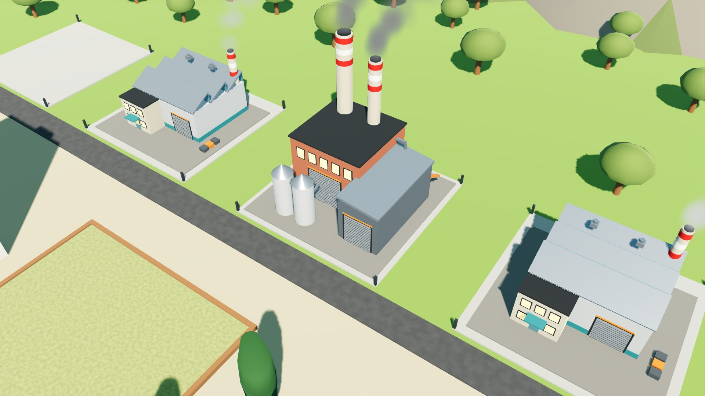
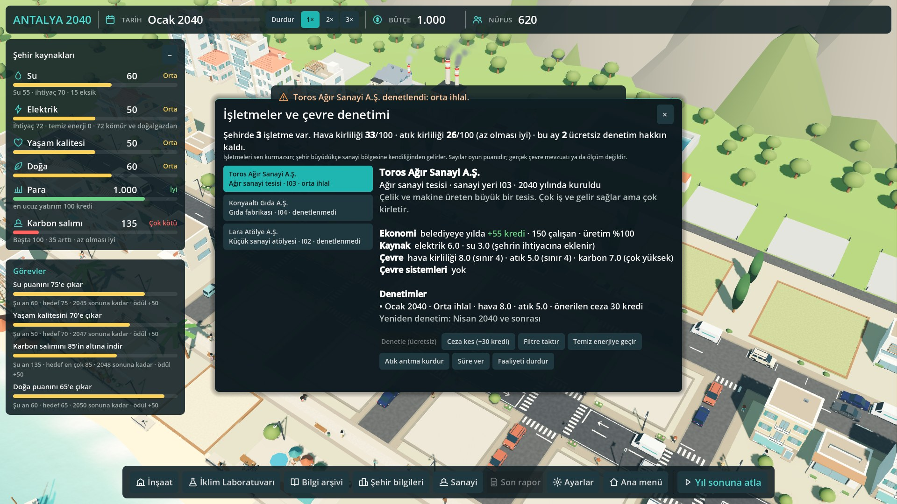

<a href="https://github.com/isikramazanoglu/antalya-2040/releases/download/v1.4/ANTALYA2040_Windows_v1.4.zip"><b>🎮 Oyunu indir (Windows)</b></a> &nbsp;·&nbsp;
<a href="https://github.com/isikramazanoglu/antalya-2040/releases/download/v1.4/oynanis_videosu.mp4"><b>🎬 Oynanış videosu</b></a> &nbsp;·&nbsp;
<a href="ANTALYA2040_Sunum.pptx"><b>📊 Sunum</b></a>

# ANTALYA 2040 · İklimin Geleceği

Antalya'dan esinlenen bir Akdeniz şehrini 2040'tan 2052'ye yönetip iklim krizlerine hazırladığın eğitici 3D şehir kurma ve iklim simülasyonu oyunu (Godot 4.7). Game Up Türkiye oyun hackathonu, COP31 temaları: iklim değişikliğine uyum ve dayanıklı şehirler, azaltım, iklim eğitimi.

## İndir ve izle
- **Oyun (Windows, v1.4):** [ANTALYA2040_Windows_v1.4.zip](https://github.com/isikramazanoglu/antalya-2040/releases/download/v1.4/ANTALYA2040_Windows_v1.4.zip) · zip'i aç, `ANTALYA2040.exe`'ye çift tıkla (kurulum ve internet gerekmez).
- **Oynanış videosu (61 sn):** [oynanis_videosu.mp4](https://github.com/isikramazanoglu/antalya-2040/releases/download/v1.4/oynanis_videosu.mp4)
- **Sunum:** [ANTALYA2040_Sunum.pptx](ANTALYA2040_Sunum.pptx) (repoda; ayrıca [Release](https://github.com/isikramazanoglu/antalya-2040/releases/download/v1.4/ANTALYA2040_Sunum.pptx))
- **Bütün sürümler:** [Releases](https://github.com/isikramazanoglu/antalya-2040/releases) · **Ekran görüntüleri:** [`docs/screenshots/final/`](docs/screenshots/final/)

 

## Temel mekanikler
- **Aylık takvim:** zaman ay ay akar (1× hızda bir ay 78 sn); Durdur, 1×, 2×, 3× ve Boşluk tuşu; "Yıl sonuna atla". Panel açıkken zaman durur.
- **Zorunlu iklim sorusu:** her ay geçişinden önce bir soru; doğru cevap verilmeden ay ilerlemez (10 soruluk banka, yanlışta açıklama).
- **12 yatırım** (güneş, kamu verimliliği, su depolama, atık su geri kazanımı, park, serinleme merkezi, kent tarımı, gıda kurtarma, kompost, toplu taşıma, verimli konut, kıyı onarımı) ve **6 kombinasyon**.
- **İşletmeler ve çevre denetimi:** şehir büyüdükçe kuzeydeki sanayi bölgesine 10 türde fabrika kendiliğinden kurulur; baca dumanı emisyona göre değişir. "Sanayi" panelinden denetim, ceza, filtre / temiz enerji / atık arıtma kararı, faaliyeti durdurma; yol kenarı araç egzoz denetimi.
- **Krizler:** sıcak hava dalgası (Temmuz 2043), kuraklık (Ağustos 2046), kıyı taşkını (Kasım 2049); aylar önce uyarı, yatırımlar zararı azaltır, kriz anında müdahale seçilir.
- **İklim Laboratuvarı:** karbon, dünyanın havası (NOAA Mauna Loa CO₂ ölçümü), su ve elektrik, tehlikeler, 17 kavramlık kaynaklı sözlük, öğrendiklerim.
- **Kayıt:** her Ocak ve ana menüye dönüşte otomatik; ana menüde "Devam et".
- **2052 final:** 7 alt puanlı değerlendirme, 2040 ↔ 2052 karşılaştırması, "Şehrin dönüşümünü izle" sinematik sunumu.

Oyundaki sayılar oyun dengeleme değerleridir; gerçek Antalya ölçümleri değildir. Bütün metinler iklim konusunu bilmeyen birinin de anlayacağı sade Türkçeyle yazıldı.

## Ekip
- **Lütfiye Işık Ramazanoğlu** · Ekip B: simülasyon, ekonomi, arayüz, entegrasyon
- **Bekir Emre Duman** · Ekip A: 3D şehir, kamera, modeller, efektler

## Çalıştırma
- **Godot:** 4.7.2 Stable Standard (C#/.NET değil). Projeyi Godot'ta `project.godot` ile açıp F5.
- **Windows demo:** yukarıdaki Release bağlantısı (ya da aşağıdaki komutla `build/` altında üretilir).
- Export: `<godot> --headless --path . --export-release "Windows Desktop" build/windows/ANTALYA2040.exe` (4.7.2 Windows export şablonları gerekir).

## Kontroller
| Tuş | İşlev |
|---|---|
| Sol tık | Arsa seç (bırakınca) |
| Sol tuşla sürükle | Haritayı kaydır |
| Boşluk | Zamanı durdur / başlat |
| Sağ tık / Esc | Seçimi bırak, paneli kapat |
| W A S D / ok tuşları | Kamerayı kaydır (ekran yönünde) |
| Tekerlek | Yakınlaş / uzaklaş |
| Orta tuş sürükle | Zemini tutup kamerayı kaydır |

Kamera açısı sabittir (izometrik görünüm); final sunumunda kamera kendiliğinden döner.

## Ana sistemler
| Sistem | Dosya | Ekip |
|---|---|---|
| Ortak sinyaller | `autoload/event_bus.gd` (sözleşme v1.9) | ortak |
| Oyun verisi | `autoload/game_state.gd`, `autoload/catalog.gd` | B |
| Kurallar ve tur | `scripts/sim/game_controller.gd`, `turn_manager.gd` | B |
| Hesaplar | `economy_simulator.gd`, `climate_simulator.gd`, `event_manager.gd`, `mission_tracker.gd`, `final_evaluator.gd` | B |
| Arayüz | `scripts/ui/` (HUD, BuildPanel, İklim Laboratuvarı, kriz paneli, raporlar) | B |
| 3D şehir, kamera, binalar, kriz görselleri | `scripts/world/`, `scenes/world/`, `scenes/buildings/` | A |
| Veri | `data/` (yatırımlar, krizler, kombinasyonlar, görevler, sözlük, CO₂) | B |

Belgeler: `docs/GAME_DESIGN.md`, `docs/INTEGRATION_CONTRACT.md`, `docs/FINAL_VISUAL_CONTRACT.md`, `docs/PROJECT_ARCHITECTURE.md`, `docs/PROGRESS.md`, `CHANGELOG.md`.

## Testler
Ekip B: `tests/` (headless: day1, day2, economy, crises, investments, final; pencereli: menu, e2e_game, ui, integration, education, playthrough), denge: `tests/balance_sim.gd`. Ekip A: `scripts/world/dev/test_*.gd`. Komutlar `CLAUDE.md`'de.

## Ekip
İki kişilik ekip, iki bilgisayar: Ekip A (3D şehir ve görseller), Ekip B (simülasyon, arayüz, entegrasyon). Harici model yok; küresel CO₂ verisi NOAA GML, bilgi kartı ve sözlük kaynakları kartlarda yazılı.
